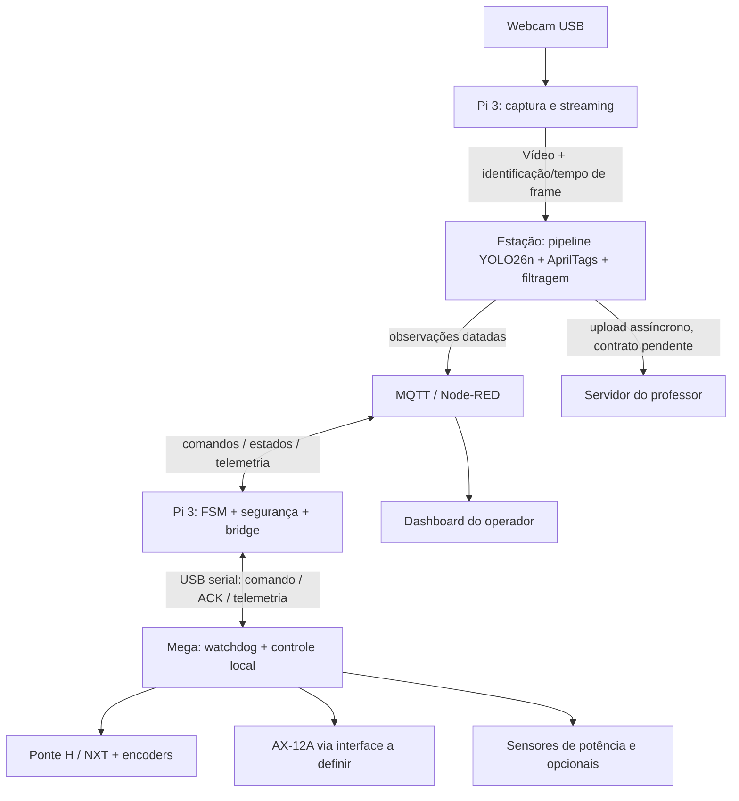
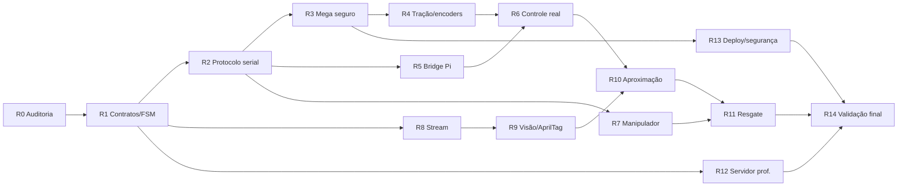

# RoboticRover — Auditoria comparativa e roadmap de software

**Data:** 16/11/2026  
**Escopo:** código, protocolos, firmware, visão computacional, integração, segurança, testes e implantação. Não é um roadmap de fabricação mecânica/elétrica, embora indique dependências de hardware que bloqueiam o software.  
**Referência de repositório:** https://github.com/DaniloCB06/RoboticRover/tree/main  
**Estado da evidência:** análise documental dos arquivos do projeto + relato de auditoria e testes fornecido pelo agente do VS Code. **O conteúdo atual do GitHub não foi obtido diretamente neste ambiente** (tentativas de consulta sem acesso útil); por isso nenhum arquivo, linha de código, teste ou estado do repositório foi independentemente verificado. As tarefas de auditoria do código são explicitamente indicadas.

## 1. Fontes e precedência

1. `Espec_projeto_RR.docx.md`: especificação principal disponibilizada, **ainda desatualizada** na parte Pi 5/inferência embarcada, e na contagem de cores/objetos.
2. `Relatorio_preProjeto_RoboticRover_ATUALIZADO_2026-11-10.md`: revisão explícita de 10/11/2026; **Pi 3 embarcada, YOLO/AprilTags na estação-base**; descrição atual proposta para arquitetura/controle. É a base da análise quando conflita com a versão mais antiga.
3. `PreProjeto_RegrasDoJogo_Projeto Robótica.pdf`, pp. 2–3: regras do professor: busca e aproximação autônomas, captura manual, transporte manual permitido, bônus por entrada autônoma na área verde com objeto, ferramenta intercambiável somente com robô parado/em espera, arena 2×2 m, zona 50×50 cm, 3 tentativas de 4 min, **5 cores × 6 formatos** (30 possibilidades, não necessariamente presentes ao mesmo tempo).
4. Material de aula: `controle_velocidade_robos_diferenciais.pptx.pdf`, `Encoders_Controle_velocidade.pptx.pdf`, `MOTORES_DC_PWM_PONTE_H.pptx.pdf`, `cinematica_e_joystick.pptx.pdf`, `Manipuladores_roboticos.pdf`, `AprilTag_OpenCV_pupil_apriltags_4_slides.pdf`, `Navegação de robôs por visão computacional - AprilTag.pdf` e `yolo.pdf`.
5. Diagnóstico do agente VS Code reproduzido na conversa: única evidência disponível sobre **o que está implementado no código**. Registros de `125 passed`, `8 skipped`, e `19 passed` para a Pi são **resultados relatados**, não reproduzidos nesta auditoria.

### Decisões já orientadas pelo projeto

- **Atualização de escopo:** não haverá sensores dedicados de distância/proximidade ou movimento/IMU. Removidos da telemetria, simuladores e dashboard; mantidos bateria, temperatura, encoders, feedback de servos e estimativa de distância por visão.

- **Pi 3**: recebe vídeo USB, transmite stream, mantém a FSM e supervisão de segurança, recebe observações MQTT, controla o Mega via serial, publica telemetria.
- **Estação-base**: Mosquitto/Node-RED/dashboard, processamento de vídeo YOLO26n + AprilTags/estimativa de distância, filtra observações, publica-as para Pi, envia resultados ao servidor do professor quando contrato disponibilizado.
- **Arduino Mega**: malha de atuação de tração e encoders, sensores, watchdog local, comunicação com servos AX-12A (diretamente via interface adequada ou via ArbotiX-M, conforme decisão de integração).
- **Captura**: manual após aproximação automática e confirmação de parada; retorno pode ser manual ou autônomo; depósito na zona verde; a troca manual de ferramenta ocorre em ESPERA com tração imobilizada.

**Conflitos a resolver nos documentos antes de congelar interfaces:** Pi 5 versus Pi 3; visão embarcada versus estação; 4 versus 5 cores; descrição antiga das ferramentas (gancho e V) versus proposta atual de garra de dupla apreensão/caçamba; atuação AX-12A via Mega diretamente versus Mega→ArbotiX (uso experimental informado pelo agente). Não transformar decisões experimentais em requisitos definitivos.

## 2. Estado do software: comparação requisito × relato do agente

| Frente | O que o projeto exige | O que o agente relata | Diagnóstico atual | Próximo resultado verificável |
|---|---|---|---|---|
| Estação-base/MQTT | Comandos e telemetria ponta a ponta, sem confundir simulação com robô | Docker/nativo + Mosquitto + Node-RED implementados | **Base aparentemente feita; integração real não demonstrada** | E2E com broker e Pi real |
| Dashboard | Vídeo, controle condicionado ao estado, ACK real, alarmes e operação manual | Interface, logs, comandos, WebSocket/API, vídeo placeholder/simulado | **Interface avançada, operação física incompleta** | Comandos e feedback reais, vídeo real, bloqueios de modo |
| Simulador Python | Simular FSM, erros, MQTT e falhas | FSM, watchdog, TTL, UUID, LWT, deduplicação, testes | **Relatado como bem desenvolvido** | Contrato unificado com cliente real; regressão |
| Cliente Raspberry Pi 3 | Supervisão da missão + webcam + MQTT + USB Mega | MQTT básico, FSM divergente, sem serial/atuação | **Parcial** | Serviço único com ponte serial, vídeo e FSM canônica |
| Protocolo MQTT | Mesmo contrato para real/simulado; observações visuais datadas | Schema só permite `simulated: true`; estados divergentes | **Incompatível com arquitetura atual** | Schemas versionados e testes cruzados |
| Protocolo Pi↔Mega | Comando/telemetria/ACK/timeout/integridade | **Ausente** | **Bloqueio crítico** | Protocolo especificado, codificado e exercitado em loopback |
| Arduino Mega | Ponte H, encoder/PID, sensores, proteção, servos | Repassador serial transparente | **Bloqueio crítico de segurança** | Firmware controlador com watchdog, estados e hardware em bancada |
| Servos AX-12A/ArbotiX | Posição, velocidade, limites e feedback reais | PING/GET/SET experimental; testes físicos 1 e 4 relatados | **Experimental** | Testes de todas as juntas com falhas/limites |
| Motores NXT | PWM/direção + realimentação se encoder validado | Ausentes do firmware funcional relatado | **Ausente** | Rodas giram/param com limites; encoder e controle de velocidade |
| Sensores reais | Bateria INA226, sensores escolhidos, alertas | Telemetria artificial; real não demonstrada | **Não comprovado** | Drivers/leituras medidas em bancada e publicadas |
| Vídeo da webcam | Pi→estação com atraso controlado | Apenas UI preparada | **Ausente** | Stream real + reconexão, medição de idade/latência |
| YOLO na estação | Detectar 6 geometrias, 5 cores na arena real | `vision/README.md` placeholder | **Código não evidenciado** | Serviço de inferência com pesos versionados/testados |
| AprilTags/distância | Estimar distância **à peça** ou invalidar medida | Não evidenciado | **Ausente** | Calibração e avaliação de erro real; associação tag↔peça |
| Navegação autônoma | Busca, seleção, alinhamento, aproximação e parada antes da peça | Ausente do robô físico | **Ausente** | Missão autônoma repetível em arena de teste |
| Captura manual | Exigir autorização, impedir avanço na captura, controlar braço | Botões/UI relatados; controle real ausente | **Ausente ponta a ponta** | Operador captura sem movimentos autônomos concomitantes |
| Retorno/depósito | Retorno manual funcional; autônomo opcional para bônus; depósito seguro | Pi tem estados; demais componentes divergentes | **Conceito parcial** | Ciclo de resgate manual completo; bônus em fase avançada |
| Servidor professor | Publicar imagens/resultados por interface futura | Não mencionado entre implementações | **Pendente contrato externo** | Adaptador com mocks; integração oficial quando requisitos recebidos |
| Deploy/segurança | Reinício, autenticação, ACL, limites e logs | Dev local; TLS/systemd faltantes | **Parcial** | Execução reprodutível e watchdog independente |
| Testes | Unidade + integração + HIL + arena | `125 passed`, `8 skipped`, `19 passed`, não reproduzidos | **Automatizados promissores, sem evidência HIL completa** | CI, broker real, compilação firmware, injeção de falhas |

**Importante:** um `SET` de servo em firmware experimental não significa que o dashboard já controla o braço. Um ACK de recebimento MQTT não significa movimento executado. Um estado na FSM da Pi não significa que a missão esteja operacional.

## 3. Arquitetura-alvo de software

Fluxo efetivo: **captura de vídeo → percepção na estação → observação com prazo de validade → decisão da FSM na Pi → referência de baixo nível no Mega → atuação/feedback → confirmação/telemetria**, com parada local do Mega se comandos expiram. O servidor do professor não participa do laço de controle.

### Contratos separadamente versionados

- `command`: solicitação validada do operador ou referência de movimento liberada pela FSM, `command_id`, versão, origem, estado esperado, `issued_at`/TTL, payload, limites; rejeitar comando vencido/duplicado/inválido.
- `observation`: `frame_id`, timestamp de aquisição, classe, confiança, `bbox`, centro/erro horizontal, estimativa de distância + validade/incerteza e identificação do alvo; **nunca usar medição inválida como distância zero**.
- `status`: estado efetivo da FSM, modo, fonte de controle, `simulated` verdadeiro/falso, conectividade e motivo de transição; o simulador nunca deve se passar pelo Rover real.
- `telemetry`: estado das rodas/encoders, servos, tensão/corrente, sensores instalados, carimbo de tempo, qualidade de medição, flags de falha; não anunciar sensor ausente como medida real.
- `ack`: estágios distintos `received`/`validated`/`dispatched`/`accepted_by_mega`/`completed` ou `failed` (nomes finais a padronizar), correlacionados por ID; **ACK de execução exige evidência física/feedback**. Evitar confundir o ACK do transporte com o término de um comando.
- `alarm`: origem, código, severidade, condição que bloqueia movimento, necessidade de rearme.

Não assumir que os tópicos exemplificativos do relatório (`rover/visao/deteccoes`, `rover/estado`, `rover/cmd/manual` etc.) são os já implementados. Definir mapeamento/migração sem quebrar testes existentes.

## 4. Roadmap em ordem executável

**Legenda de status:**
- `[x]` concluído e reproduzido;
- `[-]` parcialmente concluído;
- `[ ]` não iniciado;
- `[!]` bloqueado por hardware ou dependência externa.

### P0 — Fechar escopo e impedir comando inseguro (bloqueante, antes de teste com rodas no chão)

**[-] R0. Auditoria de código reproduzível**
- [-] Fazer checkout do commit `main` e registrar SHA/árvore de diretórios, versões de Python/Node-RED/Arduino e dependências.
- [-] Reexecutar suíte completa, contabilizando `skipped`; rodar integração MQTT com broker real; compilar firmware Mega e ArbotiX.
- [-] Mapear cada função relatada a arquivo, classe, testes e evidência; identificar código morto/duplicado e documentação antiga/ZIP histórico.
- **Aceite:** matriz requisito → implementação → teste → status, sem chamar relato de prova independente.

**[-] R1. Contratos e FSM canônicos**
- [-] Definir uma FSM que represente: `ESPERA/SEGURO`, `BUSCA`, `APROXIMACAO`, `AGUARDANDO_LIBERACAO_MANUAL`, `CAPTURA_MANUAL`, `RETORNO_MANUAL`, `RETORNO_AUTONOMO` (se implementado), `DEPOSITO`, `FALHA` ou equivalentes; separar `estado`, `modo` e `fase` se simplificar.
- [-] Definir **transições autorizadas**: aproximação→parada física→aguarda liberação→captura; proibir comandos de tração autônomos durante captura; troca de ferramenta somente ESPERA + tração parada; confirmar peça segura antes de retorno; impedir movimento automático fora das condições permitidas.
- [-] Resolver sobreposição `rover` versus `roboticrover_pi3`: preferir módulo compartilhado de contratos/segurança/FSM e adaptadores `SimulatedHardware`/`SerialHardware`, em vez de duas lógicas independentes. A escolha exige primeiro examinar código existente.
- [-] Versionar contratos com suporte explícito `simulated: true/false`, estados reais, limites uniformes de payload, origem/ACL, tempo de validade, anti-replay e tratamento de chaves JSON duplicadas; manter compatibilidade ou migração coordenada Node-RED/dashboard/Pi/simulador.
- [-] Diferenciar visualização de status **comprovado** de eventos visuais inferidos.
- **Aceite:** testes de transição, contrato cruzado, mensagens vencidas/retained/duplicadas e permissões de modo para real e simulado.

**[ ] R2. Protocolo USB serial Pi↔Mega**
- [ ] Escolher framing robusto (ex.: COBS + delimitador ou comprimento + delimitador), versão, tipo, sequência/ID, comprimento máximo e CRC-16; especificar endianness, unidades, serial baud e recuperação após corrupção.
- [ ] Mensagens mínimas: `HELLO/CAPS`, `ARM/DISARM`, `SET_WHEEL_SPEED` ou `SET_TWIST`, `STOP`, `SET_JOINT_TARGET`, `GET_TELEMETRY`, `STATUS`, `ACK/NACK`, `FAULT`, `HEARTBEAT`.
- [ ] Estabelecer limites numéricos e rejeição de comandos não finitos, fora da faixa, não autorizados, repetidos ou expirados; sequence IDs após reboot para evitar associação incorreta.
- [ ] Definir timeout de comando de movimento, heartbeat, estado seguro, política de rearme e timeouts por tipo de comando; **valores devem ser medidos/definidos em testes, não inventados**.
- [ ] Incluir simulador/loopback do protocolo e testes com mensagens truncadas, CRC inválido, ruído e reconexão. Cuidar do reset do Mega quando USB é reaberto.
- **Aceite:** comando→ACK→telemetria com IDs corretos; corrupção e silêncio levam ao estado seguro.

**[ ] R3. Firmware Mega seguro (primeiro testes SEM rodas livres no solo)**
- [ ] Inicialização com habilitação de motores desligada; separar FSM de segurança local e parser serial não bloqueante.
- [ ] Implementar watchdog independente da Pi e parada da tração em expiração; rearme deliberado, não somente reconexão.
- [ ] Priorizar STOP e falhas sobre comandos normais, sem enfileiramento que reproduza movimento antigo.
- [ ] Proteger contra limites de PWM, inversões bruscas, comandos a servos fora da faixa, tensão crítica e falhas de enlace.
- [ ] Comandar parada física/de potência por hardware quando aplicável; **software não substitui chave de emergência física**.
- [ ] Projetar política de servos em falha (manter torque versus relaxar) só após análise de risco de queda da carga.
- **Aceite:** energizar não move; cortar Pi/MQTT/serial faz cessar comando motor dentro do limite validado; falhas não rearma automaticamente.

### P1 — Tração e robô remotamente controlável

**[ ] R4. Driver dos NXT e encoders**
- [!] Confirmar pinagem NXT, tensão/corrente e tipo de ponte H efetivamente usados; implementar os dois canais de direção/PWM e estado de frenagem/costa conforme driver real.
- [!] Leitura interrupt-driven dos encoders A/B, contagem com sinal, leitura atômica e monitoramento de pulsos inválidos; calibrar CPR efetivo no eixo de roda e relação de redução.
- [ ] Implementar estimador de velocidade de cada roda e parâmetros mensuráveis `r` (raio) e `b` (bitola); converter `(v, omega)` em velocidades de roda respeitando saturações.
- [!] Testar inicialmente PWM limitado em malha aberta; depois PI/PID de roda com anti-windup, limitação e perda de pulsos; registrar diferenças real versus desejada.
- [!] Medir parada e curvas sob piso/carga/bateria; evitar assumir que PWMs iguais produzem trajetórias retas.
- **Aceite:** avançar, recuar, girar e parar, ler encoders e manter velocidades testadas; comandos cortados provocam parada local.

**[ ] R5. Ponte Raspberry Pi para hardware real**
- [ ] Supervisionar `/dev/serial/by-id/...`/porta identificada por USB, reconectar com backoff, handshake `HELLO`, detectar reboot e sincronizar sequência.
- [ ] Traduzir somente comandos permitidos pela FSM para referências do Mega; separar envio, ACK do Mega, telemetria real e conclusão de comando.
- [ ] Publicar falhas de USB, comando recusado, heartbeat, motor e servo na árvore MQTT canônica; nunca publicar `executed` sem feedback.
- [ ] Implementar fila de comandos por prioridade sem acumular comandos contínuos obsoletos; shutdown limpo e STOP.
- **Aceite:** dashboard→MQTT→Pi→Mega→tração e Mega→Pi→dashboard funcionam com registros correlacionados.

**[-] R6. Teleoperação de rodas e segurança da UI**
- [-] Controle manual de tração somente nos modos autorizados (transporte com carga, zona de resgate e situações especificamente permitidas), não usar teleop como substituto de busca/aproximação exigidas pela regra.
- [-] Comandos `hold-to-run`/dead-man com TTL, limites de velocidade e STOP ao liberar/fechar página/perder conexão; habilitação visível do modo atual.
- [-] Substituir valores simulados de bateria/temperatura por mensagens reais ou assinalar explicitamente ausência de sensor/valor simulado.
- **Aceite:** interface respeita travas e interrupção; mensagens de movimento não sobrevivem à perda do operador.

### P2 — Braço, câmera e percepção real

**[-] R7. AX-12A / ArbotiX e manipulador**
- [-] Decidir integração final: Mega→ArbotiX como coprocesso de servos **ou** Mega→barramento AX-12A via interface half-duplex apropriada. Não implementar ambas sem justificativa.
- [-] Reutilizar PING/GET/SET existentes como ensaios; testar escrita real, posições de todas as juntas, velocidade, tensão, temperatura, carga reportada e erros do protocolo Dynamixel 1.0.
- [!] Calibrar zero, limites angulares individuais e posição segura, movimentos suaves/jog; distinguir posição desejada e leitura efetiva, sem usar só ACK para presumir conclusão.
- [ ] Implementar comando manual independente por junta; cartesiano + cinemática inversa **somente depois**, caso a geometria/tempo permitam. Validar troca de ferramenta, homing seguro e travamento da tração na captura.
- **Aceite:** operador executa captura e soltura, com limites ativos, sem colisão e com telemetria de juntas.

**[-] R8. Streaming da webcam Pi→estação**
- [!] Descobrir `/dev/video*`, resoluções/FPS suportados pela webcam real, lidar com desconexão e reinício do serviço.
- [-] Implementar canal separado do MQTT para MJPEG ou WebRTC; decidir por teste de latência e facilidade, com autenticação/rede adequada.
- [ ] Incluir `frame_id`, timestamp no instante da captura e associação consistente entre frames e observações, mesmo com buffers e perdas.
- [-] Exibir vídeo na dashboard; medir atraso de captura→exibição e captura→observação→Pi. Descartar frames antigos em vez de processar fila longa.
- [ ] Pausar movimento autônomo quando stream/percepção estiverem indisponíveis ou vencidos; teleop também deve respeitar visibilidade segura.
- **Aceite:** streaming estável na Pi 3 real, reconecta e não autoriza movimento baseado em imagem antiga.

**[ ] R9. Serviço de visão na estação-base**
- [!] Empacotar pesos finais do YOLO26n, configuração de classes, versão, pré-processamento, inferência e NMS; rodar na máquina da estação (não na Pi 3).
- [ ] Executar reconhecimento das seis geometrias; validar quinta cor e fundo oficial (laranja/marrom), distâncias, reflexos e oclusões. Não tomar as métricas antigas de teste como garantia em arena.
- [ ] Tracking/associação de alvo entre quadros; filtro temporal, confiança, idade da detecção; emitir `ALVO_PERDIDO` e marcar validade.
- [!] Calibrar câmera intrinsecamente; implementar AprilTags/pose com família e tamanho **efetivamente usados**; validar autorização para tags junto à organização.
- [ ] Distinguir distância **câmera→tag** de **câmera→objeto**: usar transformação geométrica conhecida ou homografia/base do bounding box validada. Quando a distância não for confiável, enviar `distance_valid=false` e impedir aproximação métrica cega.
- [ ] Publicar observações MQTT com timestamps, `frame_id`, classe, centro/erro lateral, bbox, distância e validade; atualizar HUD para dados reais.
- **Aceite:** vídeos reais reproduzíveis com logs e erro de distância medido; observações aceitas/rejeitadas na Pi conforme idade/validade.

### P3 — Missão autônoma completa

**[ ] R10. Navegação de busca, alvo e aproximação**
- [-] Implementar a sequência BUSCA→ALVO_IDENTIFICADO→APROXIMAÇÃO→PARADA→AGUARDANDO_LIBERACAO_MANUAL na FSM da Pi, não deixar evento YOLO liberar braço diretamente.
- [ ] Selecionar alvos conforme classe/ferramenta, visibilidade, distância e viabilidade; estratégia de pontuação por **pontos/minuto medidos**, sem probabilidades inventadas.
- [ ] Busca com movimento lento e limitado, reavaliando cada frame novo; rotação/alinhamento por erro horizontal e avanço em pequenos trechos com estimativa válida.
- [ ] Usar feedback das rodas (quando validado); tolerar perda de alvo/oclusão com parada, não avançar sem observação recente; preservar margens para parede, peça e manipulador.
- [ ] Exigir confirmação de parada do Mega antes de `AGUARDANDO_LIBERACAO_MANUAL`; liberar captura somente após ação explícita do operador.
- [ ] Evitar empurrar/colidir com peças; testar prevenção de colisões por visão, sem sensores dedicados de distância/movimento.
- **Aceite:** busca e aproximação autônomas repetíveis, parada sem contato, captura liberada só com robô imóvel.

**[ ] R11. Fluxo de captura, retorno e depósito**
- [ ] Comandar garra/caçamba em `CAPTURA_MANUAL`, exigir declaração ou sensor confiável de peça presa; não presumir pelo botão de fechamento.
- [-] Permitir `RETORNO_MANUAL` conforme regras, com câmera/controles seguros; determinar condição de entrada na zona e `DEPOSITO`, soltar sem empurrar objetos.
- [ ] Registrar início/fim de ciclo e falhas de captura, troca de ferramenta somente parado/ESPERA; cronômetro de 4 min na interface é assistivo e não substitui cronômetro oficial.
- [ ] Implementar `RETORNO_AUTONOMO` **após ciclo manual funcional**, com localização da área verde, orientação/odometria e confirmação de entrada segura; retorno autônomo não autoriza captura automática.
- [ ] Avaliar pontos por minuto observados; distinguir bônus 2× só quando condição oficial foi cumprida (não apenas toggle UI).
- **Aceite mínimo:** ciclo busca→aproximação→captura manual→retorno manual→depósito em arena. **Aceite avançado:** retorno autônomo seguro repetido e demonstrado.

### P4 — Consolidação, integração externa e entrega

**[!] R12. Envio ao servidor do professor**
- [!] Solicitar contrato oficial: URL, autenticação, payload, formato de imagem/dados, frequência, políticas de upload e permissões.
- [ ] Criar adaptador assíncrono na estação-base com mocks enquanto contrato indisponível; uploads nunca bloqueiam controle ou inferência.
- [ ] Implementar fila limitada, expiração, retry/backoff, observabilidade e descarte quando exceder a capacidade.
- **Aceite:** contrato de integração homologado quando fornecido; quedas do servidor não interferem na movimentação segura do rover.

**[-] R13. Implantação, proteção e observabilidade**
- [ ] Serviços `systemd` para Pi (serial, MQTT, vídeo, FSM) com healthcheck e reinício seguro; documentação de bootstrap de Pi 3 e acesso webcam/serial.
- [-] Mosquitto com credenciais/ACL, proteção do Node-RED/API, TLS quando exigido/viável no cenário da rede, segregação de comandos e observações, sem segredos no Git.
- [-] Métricas e logs correlacionados por `command_id`, `frame_id`, boot/session ID, timestamps, latência de rede/visão, falhas e estados; diferenciar status de cada enlace.
- [-] CI: lint, testes e validação de schemas, teste integração MQTT com serviços e compilação dos firmwares (targets/placas corretamente configurados).
- [-] Fixar dependências, configuração por ambiente, exemplos sem senhas e guias de operação, recuperação de falhas e atualização.
- **Aceite:** ligar Pi/estação na configuração documentada, ver serviços saudáveis, detectar falhas e desligar seguro.

**[-] R14. Campanha de testes de integração e competição**
- [-] Unitários: FSM, validação de schema, geometria, odometria, filtros e prioridade de comando.
- [-] Integração: simulador↔broker↔Node-RED; Pi↔Mega real; AX-12A; vídeo↔visão; ACKs; schemas real/simulado.
- [-] Fault injection: Wi-Fi/broker offline, serial removida, Mega reset, imagem congelada, inferência atrasada, ruído CRC, peça desaparece, servo ausente, bateria baixa, browser fecha, comando duplicado/retained.
- [!] HIL em bancada, depois rodagem em arena, com limitação de velocidade e registro de distância de parada, taxa de sucesso, latências, FPS e pontuação efetiva por ciclo.
- [!] Executar repetidamente ciclo completo dentro dos 4 minutos, incluindo troca de ferramenta se usada; documentar vídeos/logs e ações de recuperação.
- **Aceite:** registro mensurável de segurança, repetibilidade e resgate completo; sem falhas críticas abertas.

## 5. Sequenciamento / dependências

**Trilhas paralelas que economizam tempo:** (a) firmware Mega + protocolo/bridge; (b) vídeo/YOLO/AprilTags na estação; (c) contratos/FSM/dashboard; (d) braço AX-12A. Todas convergem em R10/R11. Não esperar terminar a visão para validar STOP serial e motores; não colocar o Rover em movimento autônomo antes de R3/R4.

## 6. Dois marcos de entrega

### MVP competitivo (prioridade absoluta)
- [ ] Segurança local Mega e STOP comprovados.
- [ ] MQTT↔Pi↔Mega com controle e feedback reais.
- [ ] Tração diferencial operando com limites e encoders/controlador se validado.
- [ ] Vídeo real do Rover para a estação e dashboard.
- [ ] YOLO na estação e estimativa de aproximação validada/limitada; dados datados.
- [ ] Busca e aproximação autônomas, parada física confirmada.
- [ ] Captura manual do braço + retorno **manual** + depósito funcional.
- [ ] Modo ESPERA e troca de ferramenta seguros; alarme e recuperação de falhas.
- [!] Integração servidor professor se for exigência e contrato for disponibilizado a tempo (não omitir sem acordo com o professor).

### Avançado (após MVP estável)
- [ ] Retorno autônomo à zona verde para tentar pontuação 2×.
- [ ] Planejamento de trajetória mais elaborado, odometria por encoders e controle cartesiano/IK quando viáveis.
- [ ] Priorização estratégica baseada em taxa observada de pontos/minuto, calibração dinâmica e melhores métricas de inferência.
- [ ] Hardening adicional e monitoramento histórico sem comprometer prazo de integração.

## 7. Decisões pendentes a serem formalizadas

| Decisão | Situação | Como desbloquear código |
|---|---|---|
| Variante Pi 3 e SO | Pendente | Identificar placa, câmera, `/dev/serial*`, Wi-Fi e desempenho real |
| Arquitetura Mega↔ArbotiX↔AX-12A | Há firmware experimental, mas relatório cita Mega↔AX-12A | Escolher **um** controlador do barramento e protocolo final |
| Ponte H/motores e encoders | NXT e L298N/DRV8871 candidatos | Teste de pinagem/corrente, PWM e CPR antes dos drivers finais |
| Unificação de FSM e cliente Pi | Duas implementações divergentes, conforme agente | Revisão de código e decisão sobre biblioteca compartilhada |
| Tópicos/schemas MQTT | Proposta documental ≠ contrato implementado confirmado | Documento v2 + testes de migração |
| Taxas de mensagens e timeouts | Não congeladas | Medir latência de Wi-Fi, vídeo, loop serial e distância de parada |
| Streaming | MJPEG/WebRTC em aberto | Escolha baseada em Pi 3 real e atraso até estação |
| Família/tamanho/posição AprilTags | Em aberto; imagem fornecida não prova uso autorizado | Calibração e autorização; definir transformação tag↔peça |
| Ferramentas e juntas | Proposta atual difere da especificação antiga | Geometria/limites e comando efetivamente montados |
| Protocolo do servidor do professor | Não fornecido | Integração mock agora; implementação real após contrato |
| Estado oficial de captura/retorno | Exige implementação cruzada | Tabela de eventos e transições assinada pela equipe |

## 8. Primeira sequência de issues / PRs recomendada

1. `docs: registrar baseline, conflitos de especificação e checklist de auditoria do main` (R0).
2. `refactor(shared): FSM e schemas MQTT v2 para simulação e hardware` (R1).
3. `feat(serial): protocolo versionado + codec/CRC + mock Mega` (R2).
4. `feat(mega): parser, watchdog, STOP e rearme seguro` (R3).
5. `feat(pi): gerenciador serial e bridge MQTT com ACK real` (R5).
6. `feat(mega): motor NXT/encoder/velocidade + telemetria` (R4).
7. `feat(camera): stream Pi 3 e indicador de idade de frame` (R8, paralelamente).
8. `feat(vision): YOLO/AprilTags na estação e observações MQTT` (R9, paralelamente).
9. `feat(arm): AX-12A + controle manual + limites` (R7, paralelamente).
10. `feat(mission): busca/aproximação→captura manual→retorno manual→depósito` (R10/R11).
11. `feat(professor): adaptador assíncrono/contrato oficial` (R12, conforme dependência externa).
12. `test/ops: CI, deploy systemd e provas de segurança em bancada/arena` (R13/R14).

Em cada PR: escopo restrito, testes automatizados, atualização de contratos/docs e demonstração objetiva antes de merge. Não tratar checklist marcado como entregue sem log, vídeo ou teste reproduzível.

## 9. Matriz mínima de riscos de software

| Falha | Comportamento esperado |
|---|---|
| Pi desconecta, broker cai, Wi-Fi falha | Mega expira movimento e para; Pi permanece em modo seguro ao recuperar |
| Câmera para/quadros ficam antigos | Não seguir aproximando com observações vencidas; sinalizar alarme |
| Mensagem MQTT duplicada/retained/com TTL vencido | Rejeitar sem causar novo movimento |
| ACK USB recebido mas servo não chegou | Não publicar conclusão; consultar posição/erro ou sinalizar timeout |
| Mega reinicia ao reabrir porta | Handshake e rearme; não executar comandos do boot anterior |
| Encoder falha | Sinalizar perda de realimentação, interromper/limitar modo dependente de malha fechada |
| Objeto sumiu/medida de distância inválida | Parar aproximação ou retomar busca em condição segura |
| E-stop/STOP manual | Prioridade máxima, atuação local imediata conforme circuito, rearme controlado |
| Serviço do professor indisponível | Registrar/fila limitada; não bloquear controle, vídeo ou segurança |
| Operador troca ferramenta | Entrar ESPERA, confirmar rodas paradas, bloquear comandos até validação |

## 10. Conclusão

O código descrito pelo agente **não é um projeto finalizado**: ele representa sobretudo a **plataforma de desenvolvimento, simulação, estação-base e ensaios de firmware**. O maior risco não é ausência de telas, mas a falta de um caminho controlado e verificável entre observação e atuação física. O caminho crítico é **R1→R2→R3→R4/R5→R6**, em paralelo a **R8→R9** e **R7**, convergindo em **R10→R11→R14**. Primeiro viabilizar um resgate completo **com retorno manual**, que já é permitido, antes de tentar a bonificação de retorno autônomo.

### Referências de revisão local
- `Espec_projeto_RR.docx.md`, itens 1–7.
- `Relatorio_preProjeto_RoboticRover_ATUALIZADO_2026-11-10.md`, seções 2.1–2.3, 3.1–3.3, 4.4, 5.1–5.4, 6.1–6.4.
- `PreProjeto_RegrasDoJogo_Projeto Robótica.pdf`, pp. 2–3.
- `controle_velocidade_robos_diferenciais.pptx.pdf`, aula sobre controle diferencial, realimentação e encoders, e `Encoders_Controle_velocidade.pptx.pdf`.
- `cinematica_e_joystick.pptx.pdf`, aula sobre controle jog/IK, e `AprilTag_OpenCV_pupil_apriltags_4_slides.pdf`, calibração/pose.
- Relatório textual do agente VS Code **colado pelo usuário** nesta conversa (não verificado por checkout).
