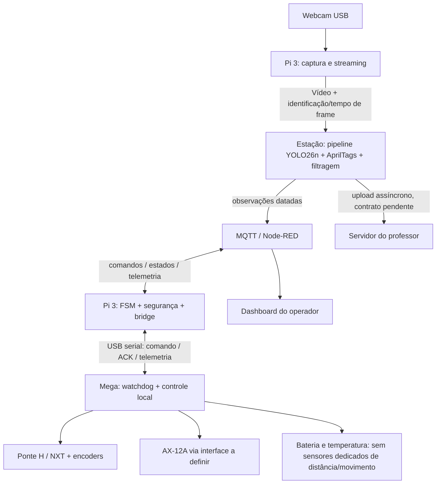
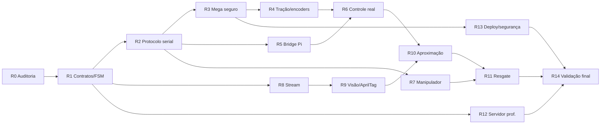

# RoboticRover — Auditoria comparativa e roadmap de software

**Data:** 16/11/2026; atualização de integração real: 17/11/2026
**Escopo:** código, protocolos, firmware, visão computacional, integração, segurança, testes e implantação. Não é um roadmap de fabricação mecânica/elétrica, embora indique dependências de hardware que bloqueiam o software.  
**Referência de repositório:** https://github.com/DaniloCB06/RoboticRover/tree/main  
**Estado da evidência:** revisão direta do checkout local, do código, contratos, fluxos Node-RED, firmware e testes. Baseline da revisão de 16/11: `48dc5ea94d90191488d56894603b0b85099f4e74`. Versão atual da `main`, já incluindo dashboard/permissões manuais e transferida à Pi em 17/11: `18ee3255869a28a07a28aa37c9459d8a902c9a01`. Foram reproduzidos **135 testes locais aprovados, 9 testes de integração MQTT aprovados e 21 testes isolados do cliente Pi aprovados**, além do teste de interface no Chrome. Os 21 testes do cliente Pi já estão incluídos nos 135; em 17/11 também foram executados na placa real. A comunicação Mac↔Pi foi validada conforme seção 2.2; atuação física continua pendente. As fontes acadêmicas citadas abaixo não estão disponíveis neste checkout para conferência independente.

## 1. Fontes e precedência

1. `Espec_projeto_RR.docx.md`: especificação principal disponibilizada, **ainda desatualizada** na parte Pi 5/inferência embarcada, e na contagem de cores/objetos.
2. `Relatorio_preProjeto_RoboticRover_ATUALIZADO_2026-11-10.md`: revisão explícita de 10/11/2026; **Pi 3 embarcada, YOLO/AprilTags na estação-base**; descrição atual proposta para arquitetura/controle. É a base da análise quando conflita com a versão mais antiga.
3. `PreProjeto_RegrasDoJogo_Projeto Robótica.pdf`, pp. 2–3: regras do professor: busca e aproximação autônomas, captura manual, transporte manual permitido, bônus por entrada autônoma na área verde com objeto, ferramenta intercambiável somente com robô parado/em espera, arena 2×2 m, zona 50×50 cm, 3 tentativas de 4 min, **5 cores × 6 formatos** (30 possibilidades, não necessariamente presentes ao mesmo tempo).
4. Material de aula: `controle_velocidade_robos_diferenciais.pptx.pdf`, `Encoders_Controle_velocidade.pptx.pdf`, `MOTORES_DC_PWM_PONTE_H.pptx.pdf`, `cinematica_e_joystick.pptx.pdf`, `Manipuladores_roboticos.pdf`, `AprilTag_OpenCV_pupil_apriltags_4_slides.pdf`, `Navegação de robôs por visão computacional - AprilTag.pdf` e `yolo.pdf`.
5. Checkout local e testes executados nesta sessão: fonte primária para **o que está implementado no código**. Os resultados antigos `125 passed`, `8 skipped` e `19 passed` foram substituídos pelos resultados atuais registrados na seção 2.1. As descrições dos documentos acadêmicos nos itens 1–4 são referências históricas, não arquivos conferidos nesta revisão.

### Decisões já orientadas pelo projeto

- **Atualização de escopo:** não haverá sensores dedicados de distância/proximidade ou movimento/IMU. Removidos da telemetria, simuladores e dashboard; mantidos bateria, temperatura, encoders, feedback de servos e estimativa de distância por visão.

- **Autorização manual definida pelo operador:** ao concluir aproximação, o Rover informa `AGUARDANDO_PEGA` e `manual_enabled: true`, inicialmente para o braço. Espaço é a exceção de parada forçada e tomada de controle, confirmada pelo controlador. Clicar em MANUAL ou enviar parada comum não cria autorização inicial. BUSCA devolve o controle ao automático. No automático, todos os botões do direcional, inclusive parar, ficam apagados/desabilitados; WASD, setas e Esc não enviam comandos manuais. O popup ⓘ explica os controles e o alternador Rover/braço identifica o destino na comunicação. Essas regras estão implementadas em software; não comprovam parada ou atuação física.

- **Pi 3**: recebe vídeo USB, transmite stream, mantém a FSM e supervisão de segurança, recebe observações MQTT, controla o Mega via serial, publica telemetria.
- **Estação-base**: Mosquitto/Node-RED/dashboard, processamento de vídeo YOLO26n + AprilTags/estimativa de distância, filtra observações, publica-as para Pi, envia resultados ao servidor do professor quando contrato disponibilizado.
- **Arduino Mega**: malha de atuação de tração e encoders, sensores, watchdog local, comunicação com servos AX-12A (diretamente via interface adequada ou via ArbotiX-M, conforme decisão de integração).
- **Captura**: manual após aproximação automática e confirmação de parada; retorno pode ser manual ou autônomo; depósito na zona verde; a troca manual de ferramenta ocorre em ESPERA com tração imobilizada.

**Conflitos a resolver nos documentos antes de congelar interfaces:** Pi 5 versus Pi 3; visão embarcada versus estação; 4 versus 5 cores; descrição antiga das ferramentas (gancho e V) versus proposta atual de garra de dupla apreensão/caçamba; atuação AX-12A via Mega diretamente versus Mega→ArbotiX (uso experimental informado pelo agente). Não transformar decisões experimentais em requisitos definitivos.

## 2. Estado do software: comparação requisito × implementação verificada

| Frente | O que o projeto exige | Implementação/evidência local | Diagnóstico atual | Próximo resultado verificável |
|---|---|---|---|---|
| Estação-base/MQTT | Comandos e telemetria ponta a ponta, sem confundir simulação com robô | 9 testes locais com simulador; em 17/11, Pi 3 real conectada por túnel SSH, 14 cenários comando/ACK e watchdog de heartbeat aprovados | **Comunicação Mac↔Pi real validada; atuação continua simulada** | E2E Pi↔Mega com feedback físico |
| Dashboard | Vídeo, controle condicionado ao estado, ACK real, alarmes e operação manual | Layout responsivo; modos no topo; Rover/Satélite; bloqueio total do direcional/teclado; alternador de destino; log único com detalhes; gráficos em popup; QA Chrome aprovado | **Interface e intertravamentos de software entregues; atuação física pendente** | Vídeo e feedback físicos; intertravamento validado no robô |
| Simulador Python | Simular FSM, erros, MQTT e falhas | FSM, watchdog, TTL, UUID, LWT, deduplicação, autorização manual e ações de braço separadas da tração, com testes | **Implementação simulada verificada** | Contrato unificado com cliente real; integração serial |
| Cliente Raspberry Pi 3 | Supervisão da missão + webcam + MQTT + USB Mega | Instalado em Pi 3 B ARM64 com Python 3.13.5; 21 testes executados na placa e MQTT real validado; ainda sem serial/atuação | **Cliente embarcado operacional para teste MQTT; integração física parcial** | Serviço único com ponte serial, vídeo e FSM canônica |
| Protocolo MQTT | Mesmo contrato para real/simulado; observações visuais datadas | Schema v1 ampliado com `manual_enabled`, `target`, `control_target`, `take_control` e `arm_motion`; schema central ainda exige `simulated: true`, enquanto a Pi usa validador próprio | **Permissões/destinos integrados; unificação e observações pendentes** | Schemas versionados e testes cruzados completos |
| Protocolo Pi↔Mega | Comando/telemetria/ACK/timeout/integridade | **Ausente** | **Bloqueio crítico** | Protocolo especificado, codificado e exercitado em loopback |
| Arduino Mega | Ponte H, encoder/PID, sensores, proteção, servos | Repassador serial transparente | **Bloqueio crítico de segurança** | Firmware controlador com watchdog, estados e hardware em bancada |
| Servos AX-12A/ArbotiX | Posição, velocidade, limites e feedback reais | PING/GET/SET experimental; testes físicos 1 e 4 relatados | **Experimental** | Testes de todas as juntas com falhas/limites |
| Motores NXT | PWM/direção + realimentação se encoder validado | Ausentes do firmware funcional relatado | **Ausente** | Rodas giram/param com limites; encoder e controle de velocidade |
| Sensores reais | Bateria/temperatura e alertas; sem sensores dedicados de distância/movimento | `proximity_cm`, radar e leituras frontais removidos, inclusive backup/ZIP; bateria/temperatura ainda artificiais | **Remoção concluída; leitura real pendente** | Drivers/leituras medidas em bancada e publicadas |
| Vídeo da webcam | Pi→estação com atraso controlado | Webcam USB real, FFmpeg/Python, MJPEG por túnel SSH, 640×480 a ~15 FPS no produtor / ~14 FPS recebidos; renderização na dashboard e recuperação de encoder testadas | **Captura e stream reais entregues; latência óptica e integração com percepção pendentes** | Medir aquisição→exibição/observação e testar reconexão USB física |
| YOLO na estação | Detectar 6 geometrias, 5 cores na arena real | `vision/README.md` placeholder | **Código não evidenciado** | Serviço de inferência com pesos versionados/testados |
| AprilTags/distância | Estimar distância **à peça** ou invalidar medida | Não evidenciado | **Ausente** | Calibração e avaliação de erro real; associação tag↔peça |
| Navegação autônoma | Busca, seleção, alinhamento, aproximação e parada antes da peça | Ausente do robô físico | **Ausente** | Missão autônoma repetível em arena de teste |
| Captura manual | Autorizar após aproximação ou parada forçada; separar braço de tração | `manual_enabled` controlado no Rover; UI bloqueada no automático; alvo `manipulator` usa ações próprias e mantém `motion: PARAR`, comprovado em testes | **Fluxo de software parcial; sem juntas, garra ou captura real** | Operador captura com limites e feedback físicos |
| Retorno/depósito | Pilotar até área segura após captura; depósito seguro; retorno autônomo opcional | Alternador permite selecionar tração durante sessão manual autorizada; estados finais, confirmação de peça e soltura ainda incompletos | **Pilotagem simulada disponível; missão física pendente** | Ciclo de resgate manual completo; bônus em fase avançada |
| Servidor professor | MQTT isolado em `rover/rover04/#`, estado da arena e vídeo WHIP | Contrato recebido; agente, ponte MQTT, vídeo H.264 e retransmissão WHIP implementados | **Parcial: homologação pendente** | Validar Pi, bateria real, vídeo e credenciais no servidor oficial |
| Deploy/segurança | Reinício, autenticação, ACL, limites e logs | Dev local; TLS/systemd faltantes | **Parcial** | Execução reprodutível e watchdog independente |
| Testes | Unidade + integração + HIL + arena | 135 locais, 9 MQTT reais, 21 Pi (subconjunto dos locais), QA Chrome desktop/mobile | **Suítes locais reproduzidas; HIL/arena ausentes** | CI, compilação firmware e injeção de falhas físicas |

**Importante:** um `SET` de servo em firmware experimental não significa que o dashboard já controla o braço. Um ACK de recebimento MQTT não significa movimento executado. Um estado na FSM da Pi não significa que a missão esteja operacional.

### 2.1. Registro de verificação local e rastreabilidade

Ambiente utilizado: macOS/Darwin 21.6.0 x64, Python da `.venv` **3.12.3**, Node.js **22.14.0**, Node-RED **4.1.10**, Mosquitto **2.0.22** e Chrome **150.0.7871.125**. A integração foi executada **sem Docker**, com broker temporário em `18883` e Node-RED em `18880`, usando cópia do fluxo com endereço/client ID isolados. O fluxo do projeto envia heartbeat a cada **1 s**, compatível com timeout local de **4 s**.

Inventário das frentes revisadas: `apps/rover/rover` (simulador), `apps/rover/roboticrover_pi3` (cliente Pi), `apps/station/node-red` (dashboard/fluxos), `shared/contracts` (contratos), `infra/mqtt` (broker), `firmware/arduino-mega`, `firmware/arbotix-board`, `vision`, `tests`, `apps/rover/tests` e `docs`. O ZIP e `.flows.json.backup` são snapshots históricos, não a fonte da dashboard e das regras manuais atuais.

| Entrega verificada | Implementação | Evidência / limite |
|---|---|---|
| Contratos, FSM, watchdog e autorização | `apps/rover/rover/`, `shared/contracts/v1/messages.schema.json` | `python -m pytest -q`: **135 passed, 9 skipped**; os 9 exigem infraestrutura e foram executados separadamente |
| Comunicação real com simulador | `tests/test_mqtt_integration.py`, `apps/station/node-red/flows.json` | `RUN_MQTT_INTEGRATION=1 MQTT_PORT=18883 NODE_RED_URL=http://127.0.0.1:18880 .venv/bin/python -m pytest -q -p no:cacheprovider -m integration`: **9 passed**; não utiliza Pi/Mega físicos |
| Cliente de preparação Pi | `apps/rover/roboticrover_pi3/`, `apps/rover/tests/` | Em `apps/rover`: `../../.venv/bin/python -m unittest discover -s tests -q`: **21 OK**, reproduzidos nesta revisão; teste roda no Mac |
| Bloqueio visual, cliques/teclado e popups | `apps/station/node-red/dashboard.html`, `tests/dashboard_browser.cjs` | `node tests/dashboard_browser.cjs`, com Chrome temporário na porta de depuração `19222`: aprovado em desktop/mobile; transporte simulado nesse teste de UI |
| Template HTML sincronizado | `apps/station/node-red/sync-dashboard.js` | Teste `test_dashboard_nodes_and_html_sync` garante igualdade com o HTML embutido em `flows.json` |
| Remoção dos sensores de distância | Simuladores, schema, HTML, `flows.json`, backup, ZIP e documentação | Commit `48dc5ea`; `test_telemetry_rejects_removed_distance_sensor` rejeita o campo antigo |
| Comunicação Mega/ArbotiX | `firmware/arduino-mega/`, `firmware/arbotix-board/` | Código lido; ensaios físicos relatados na documentação não foram reproduzidos; sem toolchain Arduino/PlatformIO disponível |

As fontes acadêmicas citadas na seção 1 não estão no checkout. A auditoria do software não confirma independentemente regras de competição, modelo de hardware, pesos YOLO ou autorização para uso de AprilTags.

### 2.2. Integração real da Pi em 17/11/2026

Versão transferida: `18ee3255869a28a07a28aa37c9459d8a902c9a01`, posterior ao baseline da revisão anterior. Pi 3 Model B Rev 1.2, Debian 13.7 ARM64, Python 3.13.5, paho-mqtt 2.2.0 e python-dotenv 1.2.4. Checkout em `/home/puc/RoboticRover`; ambiente isolado em `apps/rover/.venv`. Broker/Node-RED nativos no Mac, MQTT restrito ao loopback e transportado por túnel SSH reverso. Nenhum serviço de boot/systemd foi configurado.

Foram executados **21 testes unitários na própria Pi**, **14 cenários de comando/ACK pela estação contra o processo na Pi** e **teste de perda de heartbeat**: parar o Node-RED resultou em SEGURO_ESPERA, `manual_enabled: false` e alarme `STATION_HEARTBEAT_TIMEOUT`. O Node-RED foi reiniciado e o cliente ficou em espera. Status Linux real (`simulated: false`, hostname `puc`); comandos/estados continuam `simulated_only`. Sem GPIO/serial, atuação, streaming ou sensores reais integrados.

Ambiente, resultados e comandos para repetir estão em [docs/PI3_PRIMEIRO_TESTE_2026-11-17.md](docs/PI3_PRIMEIRO_TESTE_2026-11-17.md). Os 14 cenários são uma verificação de integração na placa; não alteram a contagem da suíte pytest local de 135 testes.

### 2.3. Webcam real integrada em 17/11/2026

A webcam UVC `1908:2310` foi identificada e capturada pelo dispositivo estável
`/dev/v4l/by-id/usb-Generic_USB2.0_PC_CAMERA-video-index0`. O novo módulo
`roboticrover_pi3.camera` roda separado do MQTT, usa FFmpeg existente e entrega
MJPEG no loopback da Pi (8080), acessível por SSH no loopback do Mac (8081).
A Visão Rover recebe o endpoint automaticamente do Node-RED, mostra FPS e
oculta quadros antigos enquanto retenta a conexão. Visão Satélite permanece
independente, sem segunda câmera instalada.

Foi observado vídeo real no Chrome, 640×480, produtor próximo de 15 FPS; uma
medição no Mac recebeu 70 quadros em 5,02 s (~13,94 FPS / 1,65 Mbps). A pausa
controlada do encoder foi detectada, seguida de reinício e recuperação da imagem
no navegador. **8 testes novos de câmera**, **29 testes do pacote executados na
Pi** e **149 testes locais aprovados / 9 ignorados**; os 14 cenários MQTT/API
contra a Pi também passaram com vídeo ativo. Os 149 incluem testes de visão já
existentes no checkout, além dos novos testes de câmera. As alterações de câmera
foram aplicadas na árvore de trabalho local e copiadas à Pi, sem novo commit.

Os timestamps identificam o recebimento do JPEG do encoder, não a exposição do
sensor. Ainda pendem latência óptica, foco/calibração, desconexão USB física,
associação com detecções e intertravamento da navegação por saúde do vídeo.
Detalhes e comandos: [docs/PI3_CAMERA.md](docs/PI3_CAMERA.md).

## 3. Arquitetura-alvo de software

Fluxo efetivo: **captura de vídeo → percepção na estação → observação com prazo de validade → decisão da FSM na Pi → referência de baixo nível no Mega → atuação/feedback → confirmação/telemetria**, com parada local do Mega se comandos expiram. O servidor do professor não participa do laço de controle.

### Contratos separadamente versionados

- `command`: solicitação validada do operador ou referência de movimento liberada pela FSM, `command_id`, versão, origem, estado esperado, `issued_at`/TTL, payload, limites; rejeitar comando vencido/duplicado/inválido.
- `observation`: `frame_id`, timestamp de aquisição, classe, confiança, `bbox`, centro/erro horizontal, estimativa de distância + validade/incerteza e identificação do alvo; **nunca usar medição inválida como distância zero**.
- `status`: estado efetivo da FSM, modo, fonte de controle, `simulated` verdadeiro/falso, conectividade e motivo de transição; o simulador nunca deve se passar pelo Rover real.
- `telemetry`: estado das rodas/encoders, servos, tensão/corrente, sensores instalados, carimbo de tempo, qualidade de medição, flags de falha; não anunciar sensor ausente como medida real.
- `ack`: estágios distintos `received`/`validated`/`dispatched`/`accepted_by_mega`/`completed` ou `failed` (nomes finais a padronizar), correlacionados por ID; **ACK de execução exige evidência física/feedback**. Evitar confundir o ACK do transporte com o término de um comando.
- `alarm`: origem, código, severidade, condição que bloqueia movimento, necessidade de rearme.

Não assumir que os tópicos exemplificativos do relatório (`rover/visao/deteccoes`, `rover/estado`, `rover/cmd/manual` etc.) são os já implementados. Definir mapeamento/migração sem quebrar testes existentes.

## 4. Roadmap em ordem executável

**Legenda de status:**

- `[x]` concluído e reproduzido;
- `[-]` parcialmente concluído;
- `[ ]` não iniciado;
- `[!]` bloqueado por hardware ou dependência externa.

Um subitem `[x]` de software/simulação não conclui o marco físico que o contém. Os marcos mantêm seus critérios de aceite completos; itens desmembrados abaixo deixam explícito o que já foi entregue.

### P0 — Fechar escopo e impedir comando inseguro (bloqueante, antes de teste com rodas no chão)

**[-] R0. Auditoria de código reproduzível**
- [x] Inspecionar a `main` local, registrar SHA, inventário das pastas, versões de Python/Node/Node-RED/Mosquitto e configuração de dependências; distinguir alterações ainda não commitadas (seção 2.1).
- [x] Executar suíte local e suíte isolada da Pi no Mac; registrar **135 aprovados / 9 ignorados** e **21 OK**, respectivamente.
- [x] Executar integração com broker/Node-RED reais e simulador, sem Docker: **9 aprovados**, incluindo controle manual e destino braço/rodas.
- [x] Instalar o checkout e as dependências em uma .venv da Pi 3 real e reproduzir os **21 testes unitários em Python 3.13/ARM64**; registrar versões e SHA (seção 2.2).
- [!] Configurar toolchains/placas e compilar os firmwares Mega e ArbotiX; registrar versões Arduino e bibliotecas utilizadas.
- [-] Mapear cada função relatada a arquivo, classe, testes e evidência; identificar código morto/duplicado e documentação antiga/ZIP histórico.
- [x] Identificar a sobreposição dos clientes `rover`/`roboticrover_pi3` e o ZIP/backup históricos; registrar a matriz de evidências local. A auditoria das fontes acadêmicas e a cobertura de firmware permanecem pendentes.
- **Aceite:** matriz requisito → implementação → teste → status, sem chamar relato de prova independente.

**[-] R1. Contratos e FSM canônicos**
- [-] Definir uma FSM que represente: `ESPERA/SEGURO`, `BUSCA`, `APROXIMACAO`, `AGUARDANDO_LIBERACAO_MANUAL`, `CAPTURA_MANUAL`, `RETORNO_MANUAL`, `RETORNO_AUTONOMO` (se implementado), `DEPOSITO`, `FALHA` ou equivalentes; separar `estado`, `modo` e `fase` se simplificar.
- [-] Definir **transições autorizadas**: aproximação→parada física→aguarda liberação→captura; proibir comandos de tração autônomos durante captura; troca de ferramenta somente ESPERA + tração parada; confirmar peça segura antes de retorno; impedir movimento automático fora das condições permitidas.
- [-] Resolver sobreposição `rover` versus `roboticrover_pi3`: preferir módulo compartilhado de contratos/segurança/FSM e adaptadores `SimulatedHardware`/`SerialHardware`, em vez de duas lógicas independentes. A escolha exige primeiro examinar código existente.
- [-] Versionar contratos com suporte explícito `simulated: true/false`, estados reais, limites uniformes de payload, origem/ACL, tempo de validade, anti-replay e tratamento de chaves JSON duplicadas; manter compatibilidade ou migração coordenada Node-RED/dashboard/Pi/simulador.
- [x] Diferenciar na dashboard disponibilidade do cliente, origem simulada e ausência de confirmação física; retirar vídeo sintético e atualizar estado pelos pacotes recebidos, não pelo botão clicado.
- [x] Publicar `manual_enabled` no estado e validar autorização nos dois clientes; espera inicial, busca, aproximação, falhas e perda de heartbeat não liberam o operador.
- [x] Implementar a exceção explícita de Espaço: `PARAR` com `take_control: true`, seguida de entrada manual somente após confirmação/autorização. Parada comum ou clicar em MANUAL não concede autorização inicial.
- [x] Separar `target: rover/manipulator`, ações permitidas por destino e `control_target` nos ACKs/estados; no simulador, ações de braço usam `arm_motion` e mantêm a tração em `PARAR`.
- [x] Remover `proximity_cm`, radar e dados de distância dedicados dos contratos, clientes, dashboard e artefatos históricos; manter bateria/temperatura e rejeitar o campo antigo no schema.
- **Aceite:** testes de transição, contrato cruzado, mensagens vencidas/retained/duplicadas e permissões de modo para real e simulado.

**[ ] R2. Protocolo USB serial Pi↔Mega**
- [ ] Escolher framing robusto (ex.: COBS + delimitador ou comprimento + delimitador), versão, tipo, sequência/ID, comprimento máximo e CRC-16; especificar endianness, unidades, serial baud e recuperação após corrupção.
- [ ] Mensagens mínimas: `HELLO/CAPS`, `ARM/DISARM`, `SET_WHEEL_SPEED` ou `SET_TWIST`, `STOP`, `SET_JOINT_TARGET`, `GET_TELEMETRY`, `STATUS`, `ACK/NACK`, `FAULT`, `HEARTBEAT`.
- [ ] Estabelecer limites numéricos e rejeição de comandos não finitos, fora da faixa, não autorizados, repetidos ou expirados; sequence IDs após reboot para evitar associação incorreta.
- [ ] Definir timeout de comando de movimento, heartbeat, estado seguro, política de rearme e timeouts por tipo de comando; **valores devem ser medidos/definidos em testes, não inventados**.
- [ ] Incluir simulador/loopback do protocolo e testes com mensagens truncadas, CRC inválido, ruído e reconexão. Cuidar do reset do Mega quando USB é reaberto.
- **Aceite:** comando→ACK→telemetria com IDs corretos; corrupção e silêncio levam ao estado seguro.

**[ ] R3. Firmware Mega seguro (primeiro testes SEM rodas livres no solo)**
- [ ] Inicialização com habilitação de motores desligada; separar FSM de segurança local e parser serial não bloqueante.
- [ ] Implementar watchdog independente da Pi e parada da tração em expiração; rearme deliberado, não somente reconexão.
- [ ] Priorizar STOP e falhas sobre comandos normais, sem enfileiramento que reproduza movimento antigo.
- [ ] Proteger contra limites de PWM, inversões bruscas, comandos a servos fora da faixa, tensão crítica e falhas de enlace.
- [ ] Comandar parada física/de potência por hardware quando aplicável; **software não substitui chave de emergência física**.
- [ ] Projetar política de servos em falha (manter torque versus relaxar) só após análise de risco de queda da carga.
- **Aceite:** energizar não move; cortar Pi/MQTT/serial faz cessar comando motor dentro do limite validado; falhas não rearma automaticamente.

### P1 — Tração e robô remotamente controlável

**[ ] R4. Driver dos NXT e encoders**
- [!] Confirmar pinagem NXT, tensão/corrente e tipo de ponte H efetivamente usados; implementar os dois canais de direção/PWM e estado de frenagem/costa conforme driver real.
- [!] Leitura interrupt-driven dos encoders A/B, contagem com sinal, leitura atômica e monitoramento de pulsos inválidos; calibrar CPR efetivo no eixo de roda e relação de redução.
- [ ] Implementar estimador de velocidade de cada roda e parâmetros mensuráveis `r` (raio) e `b` (bitola); converter `(v, omega)` em velocidades de roda respeitando saturações.
- [!] Testar inicialmente PWM limitado em malha aberta; depois PI/PID de roda com anti-windup, limitação e perda de pulsos; registrar diferenças real versus desejada.
- [!] Medir parada e curvas sob piso/carga/bateria; evitar assumir que PWMs iguais produzem trajetórias retas.
- **Aceite:** avançar, recuar, girar e parar, ler encoders e manter velocidades testadas; comandos cortados provocam parada local.

**[ ] R5. Ponte Raspberry Pi para hardware real**
- [ ] Supervisionar `/dev/serial/by-id/...`/porta identificada por USB, reconectar com backoff, handshake `HELLO`, detectar reboot e sincronizar sequência.
- [ ] Traduzir somente comandos permitidos pela FSM para referências do Mega; separar envio, ACK do Mega, telemetria real e conclusão de comando.
- [ ] Publicar falhas de USB, comando recusado, heartbeat, motor e servo na árvore MQTT canônica; nunca publicar `executed` sem feedback.
- [ ] Implementar fila de comandos por prioridade sem acumular comandos contínuos obsoletos; shutdown limpo e STOP.
- **Aceite:** dashboard→MQTT→Pi→Mega→tração e Mega→Pi→dashboard funcionam com registros correlacionados.

**[-] R6. Teleoperação de rodas e segurança da UI**
- [-] Controle manual de tração somente nos modos autorizados (transporte com carga, zona de resgate e situações especificamente permitidas), não usar teleop como substituto de busca/aproximação exigidas pela regra.
- [-] Comandos `hold-to-run`/dead-man com TTL, limites de velocidade e STOP ao liberar/fechar página/perder conexão; habilitação visível do modo atual.
- [-] Substituir valores simulados de bateria/temperatura por mensagens reais ou assinalar explicitamente ausência de sensor/valor simulado.
- [x] Reorganizar a dashboard: navbar simples, link Node-RED, barra horizontal ESPERA/BUSCA/APROXIMAÇÃO/MANUAL, vídeo à esquerda e controle à direita com estado/último ACK abaixo; validar layout desktop/mobile.
- [x] Apagar e desabilitar todos os botões do direcional, inclusive parar, e bloquear WASD/setas/Esc no automático; manter Espaço como parada forçada independente da liberação manual. Comprovar ausência de envio nos testes de navegador.
- [x] Liberar o direcional somente com `manual_enabled: true` e estado autorizado; bloquear por desconexão e revogar autorização ao retornar a BUSCA ou ocorrer falha.
- [x] Adicionar alternador Pilotar Rover/Controlar braço no canto superior direito, parar antes da troca e identificar o destino na mensagem; disponibilizar cliques, WASD e setas, com instruções em popup ⓘ no canto superior esquerdo.
- [x] Unificar estados, ACKs, conexões, avisos e erros em log com cores, filtros e popup de detalhes; conservar até 200 eventos em memória no Node-RED.
- [x] Mover gráficos de bateria/temperatura para popup sob demanda, com indicação de dados simulados e sem leituras de proximidade.
- [ ] Validar limites de velocidade e parada no hardware; completar dead-man/hold-to-run e intertravamentos físicos. Os comandos atuais são pulsos simulados de 500 ms, não controle físico contínuo.
- **Aceite:** interface respeita travas e interrupção; mensagens de movimento não sobrevivem à perda do operador.

### P2 — Braço, câmera e percepção real

**[-] R7. AX-12A / ArbotiX e manipulador**
- [-] Decidir integração final: Mega→ArbotiX como coprocesso de servos **ou** Mega→barramento AX-12A via interface half-duplex apropriada. Não implementar ambas sem justificativa.
- [-] Reutilizar PING/GET/SET existentes como ensaios; testar escrita real, posições de todas as juntas, velocidade, tensão, temperatura, carga reportada e erros do protocolo Dynamixel 1.0.
- [!] Calibrar zero, limites angulares individuais e posição segura, movimentos suaves/jog; distinguir posição desejada e leitura efetiva, sem usar só ACK para presumir conclusão.
- [ ] Implementar comando manual independente por junta; cartesiano + cinemática inversa **somente depois**, caso a geometria/tempo permitam. Validar troca de ferramenta, homing seguro e travamento da tração na captura.
- [x] Entregar interface e contrato de comandos genéricos do braço (`SUBIR`, `DESCER`, `ESQUERDA`, `DIREITA`, `PARAR`) separados das rodas e exercitados por testes Python/MQTT/browser. Não inclui juntas, garra, cinemática ou atuação física.
- **Aceite:** operador executa captura e soltura, com limites ativos, sem colisão e com telemetria de juntas.

**[-] R8. Streaming da webcam Pi→estação**
- [-] Descobrir `/dev/video*`, resoluções/FPS suportados pela webcam real, lidar com desconexão e reinício do serviço. Dispositivo e formatos confirmados; recuperação de encoder testada, falta retirar/reconectar fisicamente o USB.
- [-] Implementar canal separado do MQTT para MJPEG ou WebRTC; decidir por teste de latência e facilidade, com autenticação/rede adequada.
- [-] Incluir `frame_id`, timestamp no instante da captura e associação consistente entre frames e observações, mesmo com buffers e perdas. IDs sessão/sequência e timestamp de recebimento pós-encoder implementados; aquisição/exposição e associação a detecções continuam pendentes.
- [-] Exibir vídeo na dashboard; medir atraso de captura→exibição e captura→observação→Pi. Descartar frames antigos em vez de processar fila longa.
- [x] Implementar seleção Visão Rover/Visão Satélite, configuração independente por câmera em popup e persistência das URLs no navegador, com players MJPEG/WHEP/iframe. Validar interação da interface, sem alegar recepção de stream físico.
- [x] Identificar a webcam USB real e os formatos anunciados; capturar JPEG válido e entregar stream MJPEG separado de MQTT, sem dependências pip novas e sem acesso a atuadores.
- [x] Exibir na dashboard vídeo real da Pi por túnel SSH, com configuração automática da Visão Rover, indicador AO VIVO/FPS e endpoints de saúde/snapshot.
- [x] Manter somente o quadro mais recente, rejeitar imagens antigas, limitar clientes e reiniciar encoder interrompido; testar ocultação de imagem congelada e recuperação automática no navegador.
- [ ] Pausar movimento autônomo quando stream/percepção estiverem indisponíveis ou vencidos; teleop também deve respeitar visibilidade segura.
- **Aceite:** streaming estável na Pi 3 real, reconecta e não autoriza movimento baseado em imagem antiga.

**[ ] R9. Serviço de visão na estação-base**
- [!] Empacotar pesos finais do YOLO26n, configuração de classes, versão, pré-processamento, inferência e NMS; rodar na máquina da estação (não na Pi 3).
- [ ] Executar reconhecimento das seis geometrias; validar quinta cor e fundo oficial (laranja/marrom), distâncias, reflexos e oclusões. Não tomar as métricas antigas de teste como garantia em arena.
- [ ] Tracking/associação de alvo entre quadros; filtro temporal, confiança, idade da detecção; emitir `ALVO_PERDIDO` e marcar validade.
- [!] Calibrar câmera intrinsecamente; implementar AprilTags/pose com família e tamanho **efetivamente usados**; validar autorização para tags junto à organização.
- [ ] Distinguir distância **câmera→tag** de **câmera→objeto**: usar transformação geométrica conhecida ou homografia/base do bounding box validada. Quando a distância não for confiável, enviar `distance_valid=false` e impedir aproximação métrica cega.
- [ ] Publicar observações MQTT com timestamps, `frame_id`, classe, centro/erro lateral, bbox, distância e validade; atualizar HUD para dados reais.
- **Aceite:** vídeos reais reproduzíveis com logs e erro de distância medido; observações aceitas/rejeitadas na Pi conforme idade/validade.

### P3 — Missão autônoma completa

**[-] R10. Navegação de busca, alvo e aproximação**
- [-] Implementar a sequência BUSCA→ALVO_IDENTIFICADO→APROXIMAÇÃO→PARADA→AGUARDANDO_LIBERACAO_MANUAL na FSM da Pi, não deixar evento YOLO liberar braço diretamente.
- [ ] Selecionar alvos conforme classe/ferramenta, visibilidade, distância e viabilidade; estratégia de pontuação por **pontos/minuto medidos**, sem probabilidades inventadas.
- [ ] Busca com movimento lento e limitado, reavaliando cada frame novo; rotação/alinhamento por erro horizontal e avanço em pequenos trechos com estimativa válida.
- [ ] Usar feedback das rodas (quando validado); tolerar perda de alvo/oclusão com parada, não avançar sem observação recente; preservar margens para parede, peça e manipulador.
- [-] Integrar confirmação de chegada/parada física do Mega ao evento de fim da aproximação que libera captura. `approach_completed()` e autorização de software já existem; falta a navegação real fornecer a confirmação, sem presumir chegada por tempo ou pela interface.
- [x] Criar `approach_completed()` nos dois controladores, condicionado ao estado APROXIMACAO e heartbeat válido; no simulador também exige ausência de falha. O evento entra em AGUARDANDO_PEGA e disponibiliza o braço em software, sem disparar movimento automático do manipulador.
- [ ] Evitar empurrar/colidir com peças; testar prevenção de colisões por visão, sem sensores dedicados de distância/movimento.
- **Aceite:** busca e aproximação autônomas repetíveis, parada sem contato, captura liberada só com robô imóvel.

**[-] R11. Fluxo de captura, retorno e depósito**
- [ ] Comandar garra/caçamba em `CAPTURA_MANUAL`, exigir declaração ou sensor confiável de peça presa; não presumir pelo botão de fechamento.
- [-] Preparar retorno com câmera/controles seguros; o contrato exige navegação autônoma até a área de descarga. A pilotagem manual existente serve para testes e interrupção de segurança; em prova, pilotagem manual na navegação pode gerar penalidade.
- [x] Disponibilizar a alternância braço→pilotagem→braço em uma sessão manual autorizada, com parada na troca e separação de destinos comprovada nos testes. A coleta, o transporte até a área segura e a soltura continuam pendentes no hardware.
- [ ] Registrar início/fim de ciclo e falhas de captura, troca de ferramenta somente parado/ESPERA; cronômetro de 4 min na interface é assistivo e não substitui cronômetro oficial.
- [ ] Implementar `RETORNO_AUTONOMO` **após ciclo manual funcional**, com localização da área verde, orientação/odometria e confirmação de entrada segura; retorno autônomo não autoriza captura automática.
- [ ] Avaliar pontos por minuto observados; distinguir bônus 2× só quando condição oficial foi cumprida (não apenas toggle UI).
- **Aceite mínimo:** ciclo busca→aproximação→captura manual→retorno manual→depósito em arena. **Aceite avançado:** retorno autônomo seguro repetido e demonstrado.

### P4 — Consolidação, integração externa e entrega

**[-] R12. Envio ao servidor do professor**
- [-] Preparar WebRTC Pi→estação e forwarding WHIP estação→professor sem recodificação; cadeia reproduzida com dois MediaMTX locais e vídeo sintético. Publicação real dessa nova cadeia no servidor oficial ainda depende da rede da arena; ver `docs/WEBRTC_FORWARD.md`.
- [x] Instalar `aiortc`/`av` na Pi e validar a webcam real por WHIP→estação→WHEP no Mac: 151 quadros de 640×480 a 15,06 FPS, sem perda RTP reportada na janela de teste, e 29 testes da Pi aprovados.
- [x] Registrar o contrato de MQTT, H.264 e WHIP para a equipe `rover04`.
- [x] Implementar e reproduzir em laboratório os envios de `status`/Last Will, `state`, `mode`, `battery`, `detection`, `mission`, comandos e cópia local de `arena/state`, usando testes unitários e brokers locais.
- [x] Reproduzir captura USB real na Pi com MJPEG local e H.264 640×480/15 FPS; entregar quadros pelo Wi-Fi ao relé WHIP do Mac e ao receptor de laboratório.
- [x] Instalar e testar o agente de competição na Pi com a ponte MQTT do Mac: comando e ACK, status, bateria artificial e parada simulada por falta de renovação da velocidade.
- [-] Adicionar Visão Arena na dashboard e validar acesso à página do servidor oficial.
- [-] Limitar filas e TTL de controle, zerar velocidade simulada em perda de comandos e reconectar MQTT/WHIP.
- [!] Homologar com a Pi, o IP/credencial oficial, a bateria medida, a associação das classes YOLO e testes de parada dos motores físicos.
- **Aceite:** seguir o [roteiro de competição](docs/COMPETICAO_ROVER04.md) e reproduzir os critérios da seção 6 do contrato com o juiz.

**[-] R13. Implantação, proteção e observabilidade**
- [ ] Serviços `systemd` para Pi (serial, MQTT, vídeo, FSM) com healthcheck e reinício seguro; documentação de bootstrap de Pi 3 e acesso webcam/serial.
- [-] Mosquitto com credenciais/ACL, proteção do Node-RED/API, TLS quando exigido/viável no cenário da rede, segregação de comandos e observações, sem segredos no Git.
- [-] Métricas e logs correlacionados por `command_id`, `frame_id`, boot/session ID, timestamps, latência de rede/visão, falhas e estados; diferenciar status de cada enlace.
- [ ] Configurar CI para lint, testes, schemas, integração MQTT e compilação dos firmwares. As suítes locais existem, mas não há pipeline CI configurado.
- [-] Fixar dependências, configuração por ambiente, exemplos sem senhas e guias de operação, recuperação de falhas e atualização.
- [x] Documentar operação nativa no Mac sem Docker e atualizar README/roteiro/protocolo com permissões, destinos e novos controles da dashboard.
- [x] Disponibilizar `sync-dashboard.js` para sincronizar o HTML com o template Node-RED e verificar essa igualdade em teste automatizado.
- **Aceite:** ligar Pi/estação na configuração documentada, ver serviços saudáveis, detectar falhas e desligar seguro.

**[-] R14. Campanha de testes de integração e competição**
- [-] Unitários: FSM, validação de schema, geometria, odometria, filtros e prioridade de comando.
- [-] Integração: simulador↔broker↔Node-RED; Pi↔Mega real; AX-12A; vídeo↔visão; ACKs; schemas real/simulado.
- [-] Fault injection: Wi-Fi/broker offline, serial removida, Mega reset, imagem congelada, inferência atrasada, ruído CRC, peça desaparece, servo ausente, bateria baixa, browser fecha, comando duplicado/retained.
- [x] Reproduzir os testes Python atuais de contratos/FSM/watchdog/autorização/destino: **135 aprovados**, incluindo rejeição de ação incompatível e separação braço/tração.
- [x] Reproduzir os **9 testes MQTT locais** com Mosquitto/Node-RED nativos, incluindo ACK correlacionado por UUID, rejeições, LWT, reconexão e tomada de controle/destino do manipulador.
- [x] Validar **14 cenários Mac↔Pi real** de comando/ACK, autorização e rejeição por estado/destino; testar a perda do heartbeat da estação com retorno à espera e revogação manual. Permanecem pendentes Wi-Fi/USB físicos interrompidos, MCU, atuadores e arena.
- [x] Adicionar e executar `tests/dashboard_browser.cjs` no Chrome: bloqueio total durante automático, WASD/setas/cliques, conclusão da aproximação simulada, Espaço, alternador, popups, desconexão e responsividade. O transporte é simulado nesse teste; a comunicação real é coberta pela suíte MQTT separada.
- [x] Executar 8 testes de câmera e a suíte de 29 testes na Pi, observar stream real na dashboard e testar watchdog/recuperação do encoder; repetir os cenários MQTT com vídeo ativo. Resultado local atual: 149 aprovados / 9 ignorados (seção 2.3).
- [!] HIL em bancada, depois rodagem em arena, com limitação de velocidade e registro de distância de parada, taxa de sucesso, latências, FPS e pontuação efetiva por ciclo.
- [!] Executar repetidamente ciclo completo dentro dos 4 minutos, incluindo troca de ferramenta se usada; documentar vídeos/logs e ações de recuperação.
- **Aceite:** registro mensurável de segurança, repetibilidade e resgate completo; sem falhas críticas abertas.

## 5. Sequenciamento / dependências

**Trilhas paralelas que economizam tempo:** (a) firmware Mega + protocolo/bridge; (b) vídeo/YOLO/AprilTags na estação; (c) contratos/FSM/dashboard; (d) braço AX-12A. Todas convergem em R10/R11. Não esperar terminar a visão para validar STOP serial e motores; não colocar o Rover em movimento autônomo antes de R3/R4.

## 6. Dois marcos de entrega

### MVP competitivo (prioridade absoluta)
- [ ] Segurança local Mega e STOP comprovados.
- [ ] MQTT↔Pi↔Mega com controle e feedback reais.
- [ ] Tração diferencial operando com limites e encoders/controlador se validado.
- [x] Vídeo real do Rover para a estação e dashboard (MJPEG por túnel SSH, 640×480; seção 2.3). Calibração e integração com percepção continuam em R8/R9.
- [ ] YOLO na estação e estimativa de aproximação validada/limitada; dados datados.
- [ ] Busca e aproximação autônomas, parada física confirmada.
- [ ] Captura manual do braço + retorno **manual** + depósito funcional.
- [-] Modo ESPERA, alarmes e revogação manual implementados em software; faltam troca de ferramenta, parada física comprovada e recuperação de falhas no robô.
- [!] Integração servidor professor se for exigência e contrato for disponibilizado a tempo (não omitir sem acordo com o professor).

### Avançado (após MVP estável)
- [ ] Retorno autônomo à zona verde para tentar pontuação 2×.
- [ ] Planejamento de trajetória mais elaborado, odometria por encoders e controle cartesiano/IK quando viáveis.
- [ ] Priorização estratégica baseada em taxa observada de pontos/minuto, calibração dinâmica e melhores métricas de inferência.
- [ ] Hardening adicional e monitoramento histórico sem comprometer prazo de integração.

## 7. Decisões pendentes a serem formalizadas

| Decisão | Situação | Como desbloquear código |
|---|---|---|
| Variante Pi 3 e SO | Pendente | Identificar placa, câmera, `/dev/serial*`, Wi-Fi e desempenho real |
| Arquitetura Mega↔ArbotiX↔AX-12A | Há firmware experimental, mas relatório cita Mega↔AX-12A | Escolher **um** controlador do barramento e protocolo final |
| Ponte H/motores e encoders | NXT e L298N/DRV8871 candidatos | Teste de pinagem/corrente, PWM e CPR antes dos drivers finais |
| Unificação de FSM e cliente Pi | Duas implementações inspecionadas; permissões/destinos manuais alinhados, mas sem biblioteca única | Extrair contratos/FSM compartilhados e migrar testes dos dois clientes |
| Tópicos/schemas MQTT | Extensão v1 manual implementada e testada; incompatibilidades real/simulado e estados finais permanecem | Documento v2 + testes de migração; incluir observações visuais |
| Taxas de mensagens e timeouts | Heartbeat 1 s, timeout local 4 s, pulso manual da UI 500 ms verificados no Mac; parâmetros físicos não congelados | Medir latência de Wi-Fi, vídeo, loop serial e distância de parada no robô |
| Streaming | Players MJPEG/WHEP/iframe e seleção Rover/Satélite implementados; fonte satélite e serviço de captura ainda não definidos | Escolher transporte com Pi 3 real, fonte satélite disponível e atraso medido |
| Família/tamanho/posição AprilTags | Em aberto; imagem fornecida não prova uso autorizado | Calibração e autorização; definir transformação tag↔peça |
| Ferramentas e juntas | Proposta atual difere da especificação antiga | Geometria/limites e comando efetivamente montados |
| Protocolo do servidor do professor | Não fornecido | Integração mock agora; implementação real após contrato |
| Estado oficial de captura/retorno | Regra de autorização manual definida pelo operador e implementada em software; fase de resgate/depósito física e FSM completa pendentes | Integrar conclusão da aproximação ao Mega e fechar transições de coleta, transporte, depósito e troca de ferramenta |

## 8. Primeira sequência de issues / PRs recomendada

1. `docs: registrar baseline, conflitos de especificação e checklist de auditoria do main` (R0).
2. `refactor(shared): FSM e schemas MQTT v2 para simulação e hardware` (R1).
3. `feat(serial): protocolo versionado + codec/CRC + mock Mega` (R2).
4. `feat(mega): parser, watchdog, STOP e rearme seguro` (R3).
5. `feat(pi): gerenciador serial e bridge MQTT com ACK real` (R5).
6. `feat(mega): motor NXT/encoder/velocidade + telemetria` (R4).
7. `feat(camera): stream Pi 3 e indicador de idade de frame` (R8, paralelamente).
8. `feat(vision): YOLO/AprilTags na estação e observações MQTT` (R9, paralelamente).
9. `feat(arm): AX-12A + controle manual + limites` (R7, paralelamente).
10. `feat(mission): busca/aproximação→captura manual→retorno manual→depósito` (R10/R11).
11. `feat(professor): adaptador assíncrono/contrato oficial` (R12, conforme dependência externa).
12. `test/ops: CI, deploy systemd e provas de segurança em bancada/arena` (R13/R14).

Em cada PR: escopo restrito, testes automatizados, atualização de contratos/docs e demonstração objetiva antes de merge. Não tratar checklist marcado como entregue sem log, vídeo ou teste reproduzível.

## 9. Matriz mínima de riscos de software

| Falha | Comportamento esperado |
|---|---|
| Pi desconecta, broker cai, Wi-Fi falha | Mega expira movimento e para; Pi permanece em modo seguro ao recuperar |
| Câmera para/quadros ficam antigos | Não seguir aproximando com observações vencidas; sinalizar alarme |
| Mensagem MQTT duplicada/retained/com TTL vencido | Rejeitar sem causar novo movimento |
| ACK USB recebido mas servo não chegou | Não publicar conclusão; consultar posição/erro ou sinalizar timeout |
| Mega reinicia ao reabrir porta | Handshake e rearme; não executar comandos do boot anterior |
| Encoder falha | Sinalizar perda de realimentação, interromper/limitar modo dependente de malha fechada |
| Objeto sumiu/medida de distância inválida | Parar aproximação ou retomar busca em condição segura |
| E-stop/STOP manual | Prioridade máxima, atuação local imediata conforme circuito, rearme controlado |
| Serviço do professor indisponível | Registrar/fila limitada; não bloquear controle, vídeo ou segurança |
| Operador troca ferramenta | Entrar ESPERA, confirmar rodas paradas, bloquear comandos até validação |

## 10. Conclusão

O checkout revisado já entrega a **estação-base, simulação, dashboard responsiva, autorização manual, separação braço/rodas, comunicação com Pi real e vídeo USB/MJPEG real na dashboard**, com testes locais/MQTT/browser. Essas entregas estão marcadas individualmente como concluídas; nenhum marco R0–R14 atingiu ainda todo o seu aceite. A integração serial, a segurança local do Mega, tração/encoders, percepção integrada ao vídeo, captura/soltura e validação em arena permanecem pendentes. O caminho crítico continua **R1→R2→R3→R4/R5→R6**, em paralelo ao restante de **R8→R9** e **R7**, convergindo em **R10→R11→R14**. A primeira missão física deve completar busca/aproximação, captura manual, retorno manual e depósito antes do retorno autônomo.

### Referências de revisão local

- `Espec_projeto_RR.docx.md`, itens 1–7.
- `Relatorio_preProjeto_RoboticRover_ATUALIZADO_2026-11-10.md`, seções 2.1–2.3, 3.1–3.3, 4.4, 5.1–5.4, 6.1–6.4.
- `PreProjeto_RegrasDoJogo_Projeto Robótica.pdf`, pp. 2–3.
- `controle_velocidade_robos_diferenciais.pptx.pdf`, aula sobre controle diferencial, realimentação e encoders, e `Encoders_Controle_velocidade.pptx.pdf`.
- `cinematica_e_joystick.pptx.pdf`, aula sobre controle jog/IK, e `AprilTag_OpenCV_pupil_apriltags_4_slides.pdf`, calibração/pose.
- Checkout local e resultados reproduzidos nesta sessão, registrados na seção 2.1; os documentos acadêmicos listados acima continuam indisponíveis neste checkout para revisão independente.
